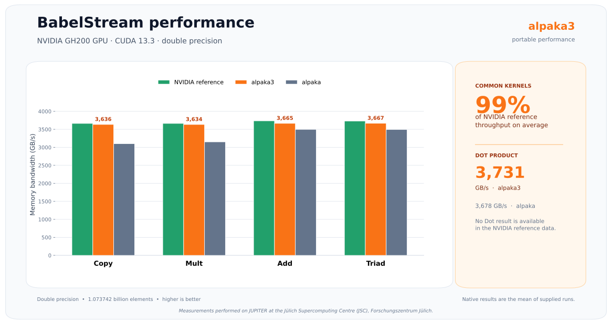
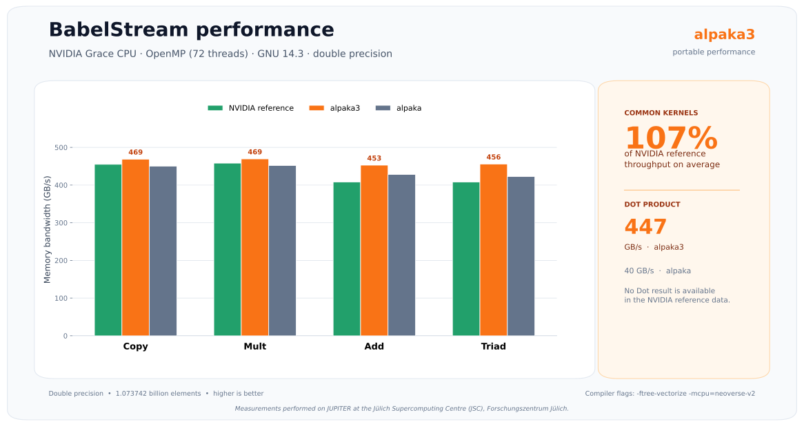

# *alpaka* — Abstraction Library for Parallel Kernel Acceleration

[](https://www.mozilla.org/en-US/MPL/2.0/)
[](https://github.com/alpaka-group/alpaka/actions/workflows/ci.yml?query=branch%3Adev_v3.x)
[](https://app.codecov.io/github/alpaka-group/alpaka/tree/dev_v3.x)
[](https://alpaka.readthedocs.io)
[](https://alpaka.readthedocs.io/en/latest/doxygen/namespaces.html)
[](https://alpaka.readthedocs.io/en/latest/doxygen_dev/namespaces.html)
[](https://isocpp.org/std/the-standard)


The **alpaka** library is a header-only C++20 abstraction library for accelerator development.

**Write parallel C++ once. Run it on CPUs and GPUs from different vendors.**

Its aim is to provide performance portability across accelerators by abstracting the underlying levels of parallelism.

The library is platform-independent and supports the concurrent and cooperative use of multiple devices, including host CPUs (x86, ARM, and RISC-V) and GPUs from different vendors (NVIDIA, AMD, and Intel).
A variety of accelerator backends—CUDA, HIP, SYCL, OpenMP, and serial execution—are available and can be selected based on the target device.
Only a single implementation of a user kernel is required, expressed as a function object with a standardized interface.
This eliminates the need to write specialized CUDA, HIP, SYCL, OpenMP, or threading code.
Moreover, multiple accelerator backends can be combined to target different vendor hardware within a single system and even within a single application.

The abstraction is based on a virtual index domain decomposed into equally sized chunks called frames.
*alpaka* provides a uniform abstraction to traverse these frames, independent of the underlying hardware.
Algorithms to be parallelized map the chunked index domain and native worker threads onto the data, expressing the computation as kernels that are executed in parallel threads (SIMT), thereby also leveraging SIMD units.
Unlike native parallelism models such as CUDA, HIP, and SYCL, *alpaka* kernels are not restricted to three dimensions.
Explicit caching of data within a frame via shared memory allows developers to fully unleash the performance of the compute device.
Additionally, *alpaka* offers primitive functions such as iota, transform, transform-reduce, reduce, and concurrent, simplifying the development of portable high-performance applications.
Host, device, mapped, and managed multi-dimensional views provide a natural way to operate on data.

## Why *alpaka*?

- **One implementation across different compute devices:** Express the computation in portable C++ and select the device and execution strategy separately.
- **Algorithms and custom kernels:** Performant and easy to use generic algorithms like `iota`, `transform`, `transformReduce`, `reduce`, or `concurrent`; write custom kernels when finer control is needed.
- **Control over parallelism:** Map work to thread hierarchies, use SIMD operations, and manage shared memory and synchronization explicitly.
- **Explicit memory and execution:** Allocate multidimensional buffers, access data through views, and submit kernels to device queues.
- **Multiple devices:** Coordinate CPU and GPU work in one application, with backend combinations determined by the available toolchains.

Performance portability also requires appropriate data layouts, work distribution, and tuning for the target hardware.
*alpaka* provides the abstractions to express these choices without maintaining a separate implementation of the algorithm for each backend.

## A dot product in one line

The dot-product operation itself is one call.
This complete CPU example also shows device selection, allocation, initialization, and synchronization.

```c++
#include <alpaka/alpaka.hpp>

#include <cstdint>
#include <functional>
#include <iostream>

int main()
{
    using namespace alpaka;

    // Select the CPU device and the corresponding asynchronous queue.
    auto device = onHost::DeviceSelector(api::host, deviceKind::cpu).makeDevice(0);
    auto queue = device.makeQueue();

    uint32_t const numElements = 128u;

    // Allocate and initialize the input buffers and a single-element result buffer for the selected device.
    concepts::IBuffer auto resultBuffer = onHost::allocUnified<double>(device, 1u);
    concepts::IBuffer auto bufferLhs = onHost::alloc<double>(device, numElements);
    onHost::iota(queue, 1.0, bufferLhs);
    concepts::IBuffer auto bufferRhs = onHost::allocLike(device, bufferLhs);
    onHost::fill(queue, bufferRhs, 42.0);

    onHost::transformReduce(queue, 0.0, resultBuffer, std::plus{}, std::multiplies{}, bufferLhs, bufferRhs);
    onHost::wait(queue);
    std::cout<<"Result="<<resultBuffer[0]<<std::endl;
}
```

Test the example on [Compiler Explorer](https://godbolt.org/z/dTcvf6rr6).

## Performance portability

The BabelStream measurements below illustrate memory-bandwidth performance on an NVIDIA GH200 GPU and a Grace CPU.
They compare the *alpaka* version 3 implementation with earlier *alpaka* version 2 and the reference implementations shown in the plots.

All results use double precision; higher bandwidth is better.
These measurements describe the hardware and benchmark configurations shown, rather than a performance guarantee for other applications or systems.

### NVIDIA GH200 GPU



### NVIDIA Grace CPU



See the [benchmark sources](benchmark) for workloads to evaluate on your own hardware.

## Contributing

See [CONTRIBUTING.md](CONTRIBUTING.md) for contribution guidelines.
Report bugs and propose improvements through [GitHub issues](https://github.com/alpaka-group/alpaka/issues).
For bug reports, include the *alpaka* commit, compiler, backend, hardware, and a minimal reproducer.

## Citation

If you use *alpaka* in research, please cite it using the metadata and publication references in [CITATION.cff](CITATION.cff).

## License

*alpaka* is licensed under the [Mozilla Public License 2.0](https://www.mozilla.org/en-US/MPL/2.0/).
